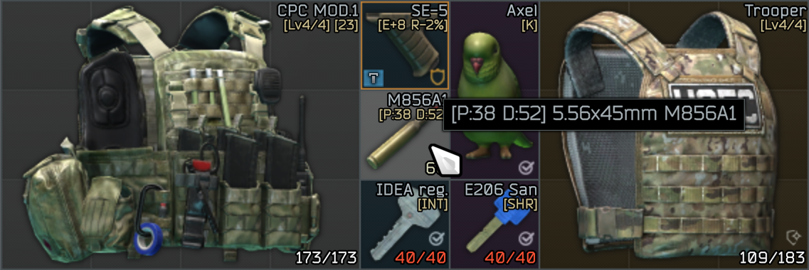

# Stat Index

The stats you look up, on the item itself, for SPT 4.1. Ammo pen and damage, armor class, key maps and more, on
every stash cell and in front of every item name.



## Features

- Ammo: penetration and damage, `[38/52]`
- Armor: armor class, `[Lv4]`, with `+` if it takes plates; the cell shows each plate fitted, front first, `-` for an
  empty slot
- Containers: grid cells inside, `[42]`
- Keys: the map its lock is on, `[SHR]`; `[CASE]` for an item's lock, `[NO USE]` when no lock uses it
- Attachments: ergonomics and recoil change, `[E+8 R-2%]`
- Collector: `[K]` on items Fence's Collector quest (Kappa) asks for
- Shows on the stash cell, and in front of the name in the inspect window, trader and flea lists, and tooltips
- Turn each one on or off, for the cell and the name separately

Key maps come from the game's own maps, and from the locks found when you play a map, so modded and backported maps
are right once you've played them. When you can pick between versions of a map, each version keeps its own keys, and a
backport you have installed wins.

The Collector list comes from your own quest list, so an edited or modded server shows what it really asks for.

## Install

1. Close the game.
2. Extract the zip into your SPT folder.

Client only. In multiplayer, install it on each player's game.

## Settings

F12 > Fums-StatIndex:

- Each type: show on the stash cell, show on full names
- Cell line: where it sits (under the name or top left), text size, colour, and whether it shows on flea offers and
  trader stock

## Build

```powershell
.\build.ps1 -SPTPath D:\SPT
```

Needs the .NET SDK and an SPT 4.1 folder.
